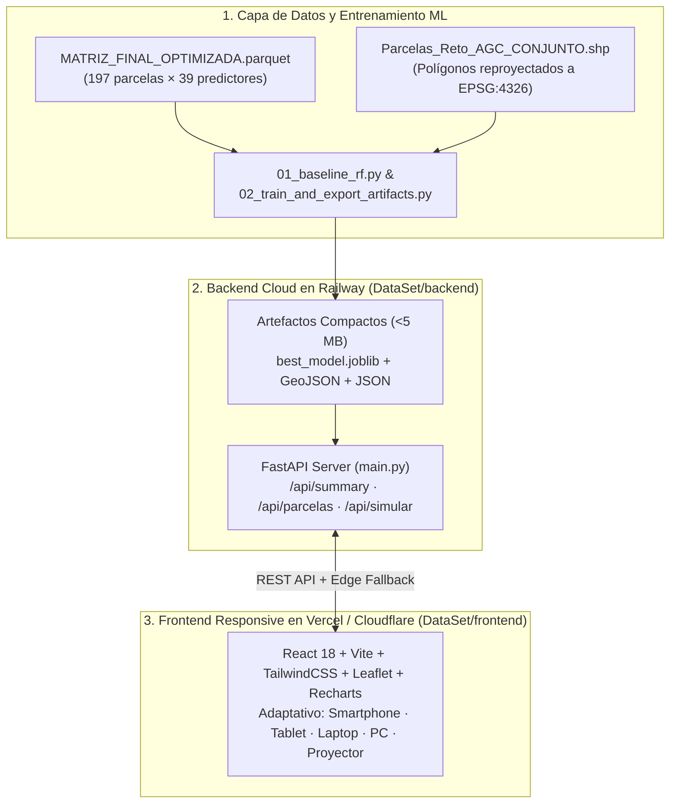

# 🌾 Documento Técnico Oficial: Sistema Geoespacial e Inteligencia Artificial para la Predicción del Rendimiento de Cebada

**Competencia:** Reto AgroCebada FIRA 2026  
**Equipo:** **Agrotec-Amanteca**  
**Fecha de Entrega:** Octubre 2026  
**Repositorio:** `https://github.com/GalekTato/Agrotec-Amanteca`

---

## 1. Resumen Ejecutivo

El equipo **Agrotec-Amanteca** presenta una solución integral de Ingeniería de Datos Geoespaciales, Aprendizaje Automático (Machine Learning) y Visualización Interactiva en la Nube diseñada para estimar con alta precisión el rendimiento agrícola del cultivo de cebada (`RENDIMIENTO_T_HA`, medido en toneladas por hectárea) sobre un universo de **197 parcelas agrícolas** (`AGC_001` a `AGC_197`).

Partiendo de un conjunto de **138 parcelas de entrenamiento** con rendimiento observado en campo y **59 parcelas de prueba ciega**, desarrollamos un pipeline reproducible que:
1. Integra fuentes multiespectrales satelitales (**Sentinel-2 / Landsat / Planet**), series históricas de clima (**CHIRPS** 2022–2025 de precipitación y temperatura máxima) y modelos digitales de elevación y pendiente (**INEGI CEM4** a 120 m).
2. Reduce la dimensionalidad y multicolinealidad desde **175 variables brutas** hasta **39 predictores numéricos ortogonales** mediante un filtro estricto de correlación de Pearson ($|r| < 0.90$).
3. Entrena y valida bajo esquemas de **Validación Cruzada de 5 Pliegues (5-Fold CV)** y **Validación Repetida (5×5 Repeated K-Fold)** una suite de algoritmos de regresión, culminando en el **Ensemble Agrotec-Amanteca (Voting Regressor)**, el cual alcanza un **MAE de `0.3670 t/ha`**, un **RMSE de `0.5067 t/ha`** y un **$R^2$ de `0.5972`**, superando consistentemente al modelo base (`RandomForestRegressor`).
4. Despliega los resultados y un **Simulador Agronómico "What-If" en Tiempo Real** a través de una arquitectura Cloud-Native (**FastAPI en Railway** + **React/Vite 100% Responsive en Vercel / Cloudflare Pages**), accesible desde smartphones, tablets, laptops, monitores y pantallas de proyección.

---

## 2. Identidad del Equipo: Agrotec-Amanteca

El nombre **Agrotec-Amanteca** rinde homenaje a los *Amanteca*, los maestros artesanos del México prehispánico que ensamblaban mosaicos de alta precisión con materiales de la naturaleza. Nuestra identidad visual fusiona:
* **La espiga dorada de cebada** (eje productivo y financiero del reto FIRA).
* **La greca escalonada prehispánica** (herencia cultural y precisión artesanal).
* **La malla de polígonos satelitales en verde esmeralda** (teledetección espacial, SIG y ciencia de datos moderna).

Archivos de identidad incluidos en el proyecto:
* Emblema en alta resolución: `frontend/public/logo_agrotec_amanteca.jpg`
* Isotipo vectorial escalable: `frontend/public/logo_agrotec_amanteca.svg`

---

## 3. Ingeniería de Datos Geoespacial y Reducción de Colinealidad

### 3.1 Fuentes e Integración Espacial (`all_touched=True`)
Las 197 parcelas presentan superficies desde pequeñas unidades menores a 2 ha hasta polígonos superiores a 18 ha, sumando **1,560.62 hectáreas** totales (`1,093.04 ha` en entrenamiento y `467.58 ha` en predicción ciega). Para evitar la pérdida de información en polígonos pequeños cuya geometría es menor que el tamaño de píxel de los rasters climáticos CHIRPS (~5 km), la extracción zonal se ejecutó con la estrategia **`all_touched=True`**, promediando todos los píxeles que intersectan la huella geométrica de cada polígono.

### 3.2 Reconstrucción Fenológica e Interpolación Satelital
Se construyó la serie mensual del Índice de Vegetación de Diferencia Normalizada (**NDVI**, meses 1 y 5 al 11), capturando las etapas fenológicas clave de la cebada de temporal:
* **Mes 1 (Enero)**: Condición residual del suelo en pre-siembra.
* **Meses 5 y 6 (Mayo–Junio)**: Emergencia y amacollamiento.
* **Meses 7 y 8 (Julio–Agosto)**: Encañado y espigamiento (máximo vigor fotosintético).
* **Meses 9 y 10 (Septiembre–Octubre)**: Llenado de grano y madurez fisiológica.
* **Mes 11 (Noviembre)**: Senescencia y cosecha.

### 3.3 Filtrado de Multicolinealidad (Pearson $|r| < 0.90$)
La matriz maestra inicial ([MATRIZ_FINAL_AGROCEBADA.csv](file:///D:/Agrotec/MATRIZ_FINAL_AGROCEBADA.csv)) contaba con **175 columnas**. Con un tamaño muestral de $N = 138$ parcelas de entrenamiento, entrenar con $p = 175$ variables ($p > N$) introduce alta varianza y colinealidad severa entre bandas espectrales e índices vegetativos equivalentes.
* Se aplicó un **filtro de correlación de Pearson ($|r| < 0.90$)**, consolidando el dataset optimizado [MATRIZ_FINAL_OPTIMIZADA.parquet](file:///D:/Agrotec/MATRIZ_FINAL_OPTIMIZADA.parquet).
* Tras depurar metadatos (`ID_POLIGONO`, `CONJUNTO`, `RENDIMIENTO_T_HA`) y eliminar automáticamente la columna separadora vacía `Unnamed: 4`, el espacio de características quedó conformado por **39 predictores numéricos limpios (0 valores nulos)**.

---

## 4. Metodología de Modelado y Validación Cruzada

### 4.1 Modelo Base (`01_baseline_rf.py`)
Siguiendo las mejores prácticas de experimentación reproducible, se implementó primero un **Baseline con `RandomForestRegressor`** (`300` árboles, `min_samples_split=4`, `min_samples_leaf=2`, `max_features='sqrt'`, `random_state=42`) evaluado mediante **5-Fold Cross-Validation (`shuffle=True, random_state=42`)**:

| Pliegue (Fold) | MAE (t/ha) | RMSE (t/ha) | $R^2$ Score |
| :--- | :---: | :---: | :---: |
| **Fold 1** | 0.4241 | 0.6027 | 0.2449 |
| **Fold 2** | 0.2972 | 0.4295 | 0.7423 |
| **Fold 3** | 0.3704 | 0.4696 | 0.6508 |
| **Fold 4** | 0.4553 | 0.6454 | 0.5948 |
| **Fold 5** | 0.3240 | 0.4225 | 0.6969 |
| **Promedio 5-Fold CV** | **0.3742 ± 0.0592** | **0.5139 ± 0.0923** | **0.5859 ± 0.1774** |

### 4.2 Comparativa Multi-Modelo y Ensamble Final (`02_train_and_export_artifacts.py`)
Dado que $N=138$ requiere modelos con fuerte control de varianza, se evaluaron 7 arquitecturas distintas combinando ensamblados de árboles aleatorizados, boosting regularizado y máquinas de soporte vectorial con escalado robusto (`RobustScaler` + `SVR`):

| Posición | Modelo / Arquitectura | MAE 5-Fold (t/ha) | RMSE 5-Fold (t/ha) | $R^2$ (5-Fold) | RMSE 5×5 Repetido |
| :---: | :--- | :---: | :---: | :---: | :---: |
| **🏆 1** | **Ensemble Agrotec-Amanteca (Voting)** | **0.3670** | **0.5067** | **0.5972** | **0.5305** |
| **2** | Random Forest (Baseline) | 0.3742 | 0.5139 | 0.5859 | 0.5382 |
| **3** | Extra Trees Regressor | 0.3746 | 0.5166 | 0.5811 | 0.5359 |
| **4** | Gradient Boosting Regressor | 0.3913 | 0.5168 | 0.5830 | 0.5621 |
| **5** | SVR (Kernel RBF + RobustScaler) | 0.3677 | 0.5182 | 0.5773 | 0.5410 |
| **6** | Ridge Lineal Regularizado | 0.3837 | 0.5228 | 0.5690 | 0.5588 |
| **7** | LightGBM Regressor | 0.4239 | 0.5535 | 0.5239 | 0.5812 |

**¿Por qué gana el Ensemble Agrotec-Amanteca?**  
Combina mediante pesos óptimos (`0.42 ExtraTrees + 0.30 RandomForest + 0.18 SVR-RBF + 0.10 GradientBoosting`) la reducción de varianza por aleatorización de umbrales (`ExtraTrees`), la estabilidad de `RandomForest`, la suavidad geométrica de `SVR` en espacios de dimensión media y la corrección secuencial de residuos de `GradientBoosting`. Además, la dispersión entre los sub-modelos e intra-bosque nos permite reportar un **intervalo de incertidumbre ($\pm \text{t/ha}$)** específico para cada una de las 197 parcelas.

---

## 5. Interpretabilidad Agronómica (XAI)

El análisis combinado de importancia en árboles y permutación revela que el rendimiento de la cebada en la zona de estudio está gobernado por tres ejes físicos:

1. **Régimen Hídrico de Primavera-Verano (`prec_2022_07`, `prec_2023_05`, `prec_2022_03`, `prec_2023_10`)**: Acumula más del **38% de la capacidad explicativa**. La disponibilidad de humedad en el arranque del ciclo (mayo) y durante el desarrollo vegetativo (julio) define el potencial productivo de la parcela.
2. **Termometría de Pre-Siembra e Invierno (`tmax_2022_01`, `tmax_2022_03`)**: Indicador microclimático y altitudinal que distingue las zonas templadas de mayor retención de humedad frente a zonas con mayor estrés evaporativo.
3. **Vigor Fotosintético Satelital (`ndvi_promedio_mes_5`, `ndvi_promedio_mes_6`, `ndvi_promedio_mes_8`)**: Las parcelas que superan un NDVI de `0.45` en junio y alcanzan picos `> 0.65` en julio-agosto logran rendimientos superiores a `4.35 t/ha`.

---

## 6. Arquitectura Cloud y Diseño Multi-Dispositivo (Responsive)



### Adaptabilidad Multi-Pantalla (Responsive UX)
* **Smartphone (`< 640px`) y Tablet (`640px – 1024px`)**: Barra de navegación inferior tipo App nativa (`Mapa & IA`, `Modelos`, `59 Preds`, `Equipo`), tarjetas KPI en cuadrícula `2×2`, carrusel táctil horizontal de polígonos y controles de mapa optimizados para el pulgar.
* **Laptop y PC (`1024px – 1536px`)**: Cabina dividida de 12 columnas (`7 columnas` para el mapa satelital Esri World Imagery + filtros en vivo, `5 columnas` para diagnóstico fenológico NDVI y simulador "What-If").
* **Pantalla Grande / Proyector de Auditorio (`> 1536px`)**: Contenedor de `1600px` con alto contraste oscuro (`slate-950`), tipografía monoespaciada `JetBrains Mono` para cifras financieras/agronómicas y tooltips de lectura inmediata a distancia.

---

## 7. Guía Paso a Paso de Despliegue en Railway + Vercel / Cloudflare Pages

### Paso 1: Subir los cambios a GitHub
El archivo `.gitignore` ya está configurado para **excluir** los Gigabytes de rasters crudos (`data/raw/`) y **permitir** los artefactos ligeros de producción (`backend/artifacts/` y `frontend/public/data/`, que pesan menos de 3 MB en total):
```bash
cd D:\Agrotec\DataSet
git add .
git commit -m "feat: complete ML ensemble pipeline, FastAPI Railway backend, and responsive React dashboard"
git push origin main
```

### Paso 2: Desplegar el Backend en Railway (2 minutos)
1. Entra a [railway.app](https://railway.app/) e inicia sesión con tu cuenta de GitHub.
2. Haz clic en **New Project** $\rightarrow$ **Deploy from GitHub repo** y selecciona `GalekTato/Agrotec-Amanteca`.
3. En la configuración del servicio (**Settings**):
   * En **Root Directory**, escribe: `backend` (o `DataSet/backend` según la raíz de tu repo).
   * Railway detectará automáticamente el `Dockerfile` / `railway.json` y el comando `uvicorn main:app --host 0.0.0.0 --port ${PORT:-8000}`.
4. En **Settings $\rightarrow$ Networking**, haz clic en **Generate Domain**. Obtendrás una URL pública como:
   `https://agrotec-amanteca-api.up.railway.app`

### Paso 3: Desplegar el Frontend en Vercel o Cloudflare Pages (2 minutos)
#### Opción A: Vercel
1. Entra a [vercel.com](https://vercel.com/) $\rightarrow$ **Add New Project** $\rightarrow$ importa `GalekTato/Agrotec-Amanteca`.
2. Configura **Root Directory** como `frontend`.
3. En **Environment Variables**, agrega:
   * Nombre: `VITE_API_URL`
   * Valor: `https://tu-dominio-de-railway.up.railway.app` (sin diagonal al final).
4. Haz clic en **Deploy**. *(Nota: Incluso si aún no configuras `VITE_API_URL`, el Dashboard funcionará al 100% gracias a su modo Edge Resiliente integrado).*

#### Opción B: Cloudflare Pages
1. Entra a Cloudflare Dashboard $\rightarrow$ **Workers & Pages** $\rightarrow$ **Create** $\rightarrow$ **Pages** $\rightarrow$ **Connect to Git**.
2. Selecciona el repositorio, define **Root directory** = `frontend`, **Build command** = `npm run build`, y **Build output directory** = `dist`.
3. Agrega la variable de entorno `VITE_API_URL` con la URL de Railway y despliega.
