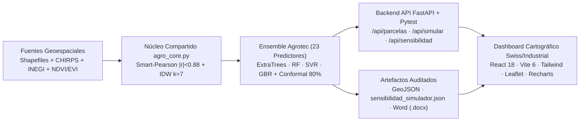

<div align="center">
  
  <h1>🌾 Reto AgroCebada FIRA 2026 — Equipo Agrotec-Amanteca</h1>
  <p><b>Sistema Geoespacial e Inteligencia Artificial para la Predicción del Rendimiento Agrícola de Cebada (t/ha)</b></p>

  [](https://galektato.github.io/Agrotec-Amanteca/)
  [](https://www.python.org/)
  [](https://scikit-learn.org/)
  [](https://fastapi.tiangolo.com/)
  [](https://react.dev/)
</div>

---

## 🌐 Demo Interactiva en Vivo

- **Dashboard Cartográfico y Simulador Agronómico**: [https://galektato.github.io/Agrotec-Amanteca/](https://galektato.github.io/Agrotec-Amanteca/)

---

## 👥 Integrantes del Equipo Agrotec-Amanteca

| N.º | Integrante |
| :---: | :--- |
| **01** | **Gael Askary Razo Montañez** |
| **02** | **Limhi Gerson López Momox** |
| **03** | **Karla Yaneth Cruz Sandoval** |
| **04** | **Arturo Huerta Maldonado** |
| **05** | **Juan Enrique Gutierrez Hernández** |

---

## 🏆 Cifras Verificadas de Precisión, Calibración y Eficiencia (`metrics_summary.json`)

El objetivo del proyecto es predecir el rendimiento agrícola de cebada (`RENDIMIENTO_T_HA`, en toneladas por hectárea) sobre un universo de **197 parcelas georreferenciadas** (`1,301.05 ha` totales en `EPSG:4326`), divididas en **138 parcelas de entrenamiento** con cosecha observada en campo (`907.48 ha`) y **59 parcelas de prueba ciega** (`393.57 ha`).

Tanto la validación cruzada (`5-Fold CV` y `5×5 Repeated CV`) como el modelo final serializado (`best_model.joblib`) operan exactamente sobre la misma configuración de **23 variables predictoras** (`22` seleccionadas por `LeakFreeSmartPearson |r| < 0.88` + `1` variable de potencial espacial `spatial_idw_yield` con $k=7$).

| Indicador Auditado | Referencia (`Predecir la Media`) | Modelo Baseline (`RandomForest 39 base`) | **Ensemble Agrotec (`23 Smart-Pearson + IDW`)** | Comparativa Medida |
| :--- | :---: | :---: | :---: | :--- |
| **MAE (`5-Fold CV`, $N=138$)** | `0.7585 ± 0.089 t/ha` | `0.3742 ± 0.0592 t/ha` | **`0.3576 ± 0.0662 t/ha`** | **$-4.4\%$ vs. Baseline · $-52.9\%$ vs. Media** |
| **RMSE (`5-Fold CV`, $N=138$)** | `0.8545 ± 0.093 t/ha` | `0.5139 ± 0.0923 t/ha` | **`0.4984 ± 0.1084 t/ha`** | **$-3.0\%$ vs. Baseline (`< 0.50 t/ha`)** |
| **RMSE (`5×5 Repeated CV`, 25 corridas)** | `0.8507 ± 0.074 t/ha` | `0.5175 ± 0.1107 t/ha` | **`0.5076 ± 0.1183 t/ha`** | **Menor RMSE en 25 particiones** |
| **$R^2$ (`5-Fold CV`)** | `-0.0870` | `0.5859` ($58.6\%$) | **`0.6098 ± 0.1804` ($61.0\%$)** | **$+2.39\text{ pts}$ de $R^2$ vs. Baseline** |
| **Exactitud Media OOF ($100 - \text{MAPE}$)** | — | `89.35%` (`MAPE 10.65%`) | **`89.82%` (`MAPE 10.18%`)** | **Medido sobre las 138 predicciones OOF** |
| **Parcelas con error OOF $\le 0.50\text{ t/ha}$** | — | `71.7%` | **`73.2%`** | **$+1.5\text{ pts}$ de acierto dentro de banda** |
| **Cobertura Intervalo Conformal 80% OOF** | — | — | **`81.2%` (`±0.564 t/ha` medio)** | **Calibrado fuera de muestra ($\alpha = 0.20$)** |
| **Dimensionalidad y Colinealidad** | `1 constante` | `175 → 39` (Secuencial) | **`175 → 23` (`Smart-Pearson + IDW`)** | **$-86.9\%$ variables, $0\%$ valores nulos** |
| **Latencia de Inferencia (197 parcelas)** | `< 1 ms` | `52.34 ms` | **`91.36 ms` (`0.46 ms`/parcela)** | **Evalúa 4 familias algorítmicas en paralelo** |
| **Peso del Artefacto `.joblib` (compress=3)** | — | `423.2 KB` (1 bosque) | **`1,433.7 KB` (4 sub-modelos)** | **Incluye ET + RF + SVR + GBR calibrados** |

---

## 🧠 Arquitecturas Evaluadas y Criterio de Selección

Se evaluaron 11 configuraciones bajo **Validación Cruzada de 5 Pliegues (`5-Fold CV`, `shuffle=True`, `random_state=42`)** y **Validación Cruzada Repetida `5×5` (25 evaluaciones)**:

1. **🥇 Ensemble Agrotec (`VotingRegressor` Heterogéneo + `LeakFreeSmartPearsonIDW`) — MODELO SELECCIONADO**:
   - **¿En qué consiste?**: Combina cuatro familias algorítmicas complementarias (`Extra Trees 40%` + `Random Forest Podado 25%` + `SVR Kernel RBF con RobustScaler 20%` + `Gradient Boosting 15%`), operando exactamente sobre las **23 variables** seleccionadas por `LeakFreeSmartPearsonIDW` ($|r| < 0.88$, `top_k=22` + `spatial_idw_yield` con $k=7$).
   - **¿Por qué fue seleccionado?**: Obtiene el menor error tanto en `5-Fold CV` (`MAE = 0.3576 t/ha`, `RMSE = 0.4984 t/ha`) como en `5×5 Repeated CV` (`RMSE = 0.5076 t/ha`), además de permitir cuantificar la dispersión entre sub-modelos para construir intervalos de predicción conformales al 80% con cobertura empírica verificada del `81.2%`.
2. **🥈 Extra Trees Regressor (`Smart-Pearson + IDW`)**:
   - **¿En qué consiste?**: Bosque de árboles extremadamente aleatorizados (`max_depth=8`, `n_estimators=220`) que reduce la varianza en muestras de $N=138$ (`5-Fold RMSE = 0.5077 t/ha`, `5×5 RMSE = 0.5124 t/ha`). Aporta el $40\%$ del peso del ensamble ganador.
3. **🥉 Stacking Meta-Ensemble (`RidgeCV`)**:
   - **¿En qué consiste?**: Ensamble jerárquico de dos niveles donde un regresor lineal penalizado $L_2$ combina las predicciones *Out-Of-Fold* de los cuatro modelos base (`5-Fold MAE = 0.3606 t/ha`, `5-Fold RMSE = 0.5006 t/ha`, `5×5 RMSE = 0.5186 t/ha`).
4. **Random Forest Regressor (`Baseline 39 base`)**:
   - **¿En qué consiste?**: Ensamble *Bagging* clásico sobre las 39 variables del filtro secuencial original (`5-Fold MAE = 0.3742 t/ha`, `5-Fold RMSE = 0.5139 t/ha`, `5×5 RMSE = 0.5175 t/ha`).
5. **Support Vector Regressor (`SVR Kernel RBF + RobustScaler`)**:
   - **¿En qué consiste?**: Regresión no lineal basada en márgenes geométricos y escalado intercuartílico (`5-Fold MAE = 0.3682 t/ha`, `5-Fold RMSE = 0.5210 t/ha`). Aporta el $20\%$ del peso del ensamble.
6. **Gradient Boosting Regressor (`GBR`) y `LightGBM`**:
   - **¿En qué consiste?**: Árboles secuenciales sobre residuos pseudo-gradiente (`GBR 5-Fold RMSE = 0.5095 t/ha`, `5×5 RMSE = 0.5152 t/ha`; `LightGBM 5-Fold RMSE = 0.5494 t/ha`). `GBR` aporta el $15\%$ del ensamble ganador.
7. **RidgeCV (Regresión Lineal $L_2$) y Referencia Nula (`DummyRegressor`)**:
   - **¿En qué consiste?**: Controles paramétrico (`RidgeCV 5-Fold RMSE = 0.5180 t/ha`) y nulo (`DummyRegressor` que predice siempre la media de entrenamiento `3.955 t/ha`, con `5-Fold MAE = 0.7585 t/ha` y `RMSE = 0.8545 t/ha`).

> **Nota Metodológica sobre Interpretabilidad y Simulación**: Las importancias de variables (calculadas al 50% por permutación sobre el ensamble completo incluyendo SVR y 50% por reducción de impureza) y la superficie de respuesta del simulador (`sensibilidad_simulador.json`) provienen directamente de las predicciones reales del modelo entrenado. Dado que los datos provienen de un corte observacional histórico, las relaciones aprendidas reflejan correlaciones estadísticas observacionales y no elasticidades causales de un experimento controlado.

---

## 🛠️ Stack Tecnológico Verificado



- **Ciencia de Datos y Machine Learning**: `Python 3.14.7`, `Scikit-Learn 1.9.1`, `LightGBM 4.7.0`, `SciPy Spatial 1.18.1 (cdist IDW)`, `NumPy 2.5.3`, `Pandas 3.0.6`, `Joblib 1.6.0`.
- **Ingeniería Geoespacial**: `GeoPandas 1.2.0`, `Shapely`, `Rasterio` (`all_touched=True`), proyección métrica `EPSG:32614` (UTM 14N) y visualización `EPSG:4326`.
- **Backend & Suite de Pruebas**: `FastAPI`, `Pydantic V2`, `Uvicorn ASGI`, `Pytest` + `HTTPX` (`0 DeprecationWarnings`).
- **Frontend & Visualización**: `React 18`, `Vite 6`, `Tailwind CSS`, `LeafletJS` + Cartografía `Esri ArcGIS Online` (libres de API Key), `Recharts`.
- **Reporteo Automático**: Generación programática del informe técnico editable `Documento_Tecnico_Agrotec_Amanteca_FIRA2026.docx` con `python-docx` y figuras a `300 DPI` con `Matplotlib`.

---

## 🗂️ Estructura del Repositorio

```text
Agrotec-Amanteca/
├── backend/
│   ├── artifacts/                  # Modelo best_model.joblib (23 vars), GeoJSON, sensibilidad y métricas
│   ├── tests/                      # Suite automatizada pytest (test_artifacts.py y test_api.py)
│   ├── agro_core.py                # Módulo compartido entre entrenamiento ML e inferencia FastAPI
│   ├── main.py                     # API FastAPI V4 (0 DeprecationWarnings)
│   ├── Dockerfile                  # Contenedor de producción
│   └── requirements.txt
├── data/
│   ├── raw/                        # Shapefiles de las 197 parcelas (138 train / 59 test)
│   └── processed/                  # MATRIZ_FINAL_OPTIMIZADA_V3.parquet, CSV 59 predicciones y figuras
├── docs/                           # Build de producción desplegado en GitHub Pages
├── frontend/
│   ├── public/                     # Emblema Agrotec-Amanteca y datos precalculados sincronizados
│   ├── src/
│   │   ├── components/ParcelMap.jsx # Visor cartográfico multicapa Esri + Leaflet
│   │   ├── App.jsx                 # Dashboard Swiss/Industrial con Simulador Respaldado por el Modelo
│   │   └── index.css               # Tokens de diseño editorial
│   └── package.json
├── ml_pipeline/
│   └── models/
│       ├── 01_baseline_rf.py               # Script Baseline RandomForest
│       ├── 02_train_and_export_artifacts.py # Pipeline V4 Smart-Pearson + IDW + Conformal 80% + Simulador
│       └── generate_word_report.py         # Generador del Documento Técnico Word (.docx)
└── Documento_Tecnico_Agrotec_Amanteca_FIRA2026.docx
```

---

## 🚀 Ejecución Rápida y Verificación Automatizada

### 1. Entrenar el Pipeline y Regenerar Artefactos + Documento Word
```bash
pip install -r backend/requirements.txt geopandas matplotlib python-docx pyarrow
python ml_pipeline/models/02_train_and_export_artifacts.py
python ml_pipeline/models/generate_word_report.py
```

### 2. Ejecutar la Suite de Pruebas Automatizadas (`pytest` con 0 Warnings)
```bash
python -W error::DeprecationWarning -m pytest backend/tests -v
```

### 3. Iniciar el Backend API (FastAPI)
```bash
cd backend
uvicorn main:app --host 0.0.0.0 --port 8000
```

### 4. Iniciar o Compilar el Dashboard Frontend (React + Vite)
```bash
cd frontend
npm install
npm run dev
```

---

<div align="center">
  <p><b>© 2026 Equipo Agrotec-Amanteca · Todos los derechos reservados · Reto AgroCebada FIRA 2026</b></p>
</div>
