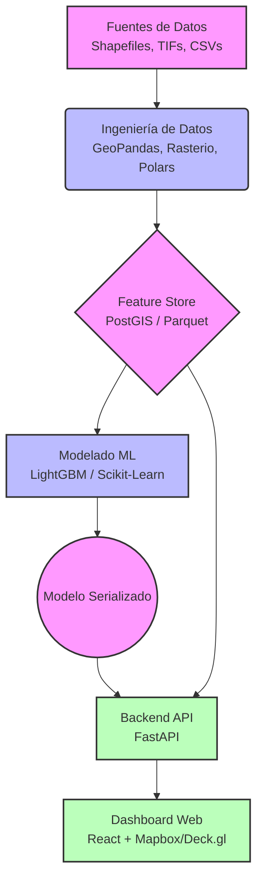

# 🌾 Reto AgroCebada FIRA 2026 - Equipo Agrotec-Amanteca

[](https://www.python.org/)
[](https://fastapi.tiangolo.com/)
[](https://reactjs.org/)
[](https://postgis.net/)

Solución tecnológica y modelo predictivo para estimar el rendimiento del cultivo de cebada (t/ha) utilizando datos espaciales, series temporales satelitales y variables climáticas.

---

## 🏗️ Arquitectura del Proyecto

El proyecto está diseñado como una solución de software funcional orientada a la toma de decisiones agronómicas.



## 🗂️ Estructura del Repositorio

La arquitectura del repositorio separa claramente el análisis de datos de las aplicaciones web:

* **`/data/`**: Carpeta local para almacenamiento de datos (Ignorada por Git).
  * `/raw/`: Datos originales (CSVs masivos, Rasters, Shapefiles).
  * `/interim/`: Datos intermedios de procesamiento.
  * `/processed/`: Features finales listas para entrenamiento.
* **`/notebooks/`**: Jupyter Notebooks para Análisis Exploratorio de Datos (EDA) y experimentación visual.
* **`/ml_pipeline/`**: Scripts core de Python para el pipeline de datos.
  * `/ingestion/`: Lectura y estandarización de fuentes.
  * `/features/`: Extracción espacial (Zonal stats) y temporal.
  * `/models/`: Entrenamiento, validación y optimización.
* **`/backend/`**: API REST en FastAPI que sirve las predicciones.
* **`/frontend/`**: Aplicación React + Vite para el Dashboard interactivo.

## 🚀 Guía de Instalación (Setup Local)

### 1. Clonar el repositorio
```bash
git clone https://github.com/GalekTato/Agrotec-Amanteca.git
cd Agrotec-Amanteca
```

### 2. Configurar los Datos (¡Importante!)
Debido a su tamaño, los datos originales no están en GitHub. Para poder ejecutar el código:
1. Descarga los datasets originales proporcionados por el reto (Carpetas CHIRPS, INEGI, CSVs satelitales, Shapefiles).
2. Colócalos exactamente dentro de la carpeta `data/raw/` de tu repositorio local.

### 3. Entorno de Python (Backend y ML Pipeline)
*(Instrucciones de dependencias pendientes)*
```bash
# Ejemplo:
# python -m venv venv
# source venv/bin/activate
# pip install -r requirements.txt
```

### 4. Entorno de Frontend
*(Instrucciones de Node.js pendientes)*
```bash
# cd frontend
# npm install
# npm run dev
```

## 👥 Equipo y Roles

* 🌍 **Data Engineer (Geoespacial)**: Procesamiento de rasters y shapefiles.
* 🧠 **Data Scientist / ML Engineer**: Feature engineering y entrenamiento del modelo predictivo.
* ⚙️ **Backend Developer**: Desarrollo de la API (FastAPI) e integración del modelo.
* 🎨 **Frontend Developer**: Creación del dashboard interactivo y visualización de mapas.
* 🚀 **DevOps / Integrador**: Orquestación, despliegues (Vercel/Railway) y arquitectura general.
