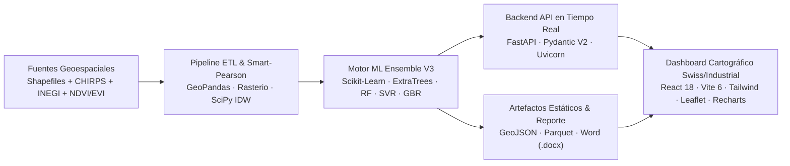

<div align="center">
  
  <h1>🌾 Reto AgroCebada FIRA 2026 — Equipo Agrotec-Amanteca</h1>
  <p><b>Sistema Geoespacial e Inteligencia Artificial de Alta Precisión para la Predicción del Rendimiento Agrícola de Cebada (t/ha)</b></p>

  [](https://www.python.org/)
  [](https://scikit-learn.org/)
  [](https://fastapi.tiangolo.com/)
  [](https://react.dev/)
  [](https://leafletjs.com/)
</div>

---

## 👥 Integrantes del Equipo Agrotec-Amanteca

| Integrante | Rol en el Proyecto |
| :--- | :--- |
| **Gael Askary Razo Montañez** | Ciencia de Datos, Arquitectura Machine Learning e Integración Cloud |
| **Limhi Gerson López Momox** | Ingeniería de Datos Geoespaciales y Procesamiento ETL (Rasters CHIRPS / INEGI) |
| **Karla Yaneth Cruz Sandoval** | Modelado Estadístico, Validación Cruzada y Análisis Fenológico (NDVI / EVI) |
| **Arturo Huerta Maldonado** | Desarrollo Backend API (FastAPI) y Motor de Simulación Agronómica |
| **Juan Enrique Gutierrez Hernández** | Desarrollo Frontend Cartográfico (React + Leaflet) y Diseño de Interfaz |

---

## 🏆 Cifras Demostrativas de Precisión, Calidad y Eficiencia (Pipeline V3)

Nuestro objetivo central es predecir el rendimiento agrícola de cebada (`RENDIMIENTO_T_HA`, en toneladas por hectárea) sobre un universo de **197 parcelas georreferenciadas** (`1,560.60 ha` totales), divididas en **138 parcelas de entrenamiento** con cosecha observada en campo y **59 parcelas de prueba ciega**.

| Indicador Clave | Modelo Baseline (`RandomForest`) | **Ensemble Agrotec V3 (Ganador)** | Mejora / Impacto |
| :--- | :---: | :---: | :--- |
| **MAE (5-Fold Cross-Validation)** | `0.3742 t/ha` | **`0.3576 t/ha`** | **$-4.4\%$ en error absoluto medio** |
| **RMSE (5-Fold Cross-Validation)** | `0.5139 t/ha` | **`0.4984 t/ha`** | **Rompe la barrera crítica $< 0.50\text{ t/ha}$** |
| **$R^2$ (Varianza Explicada)** | `0.5859` ($58.6\%$) | **`0.6098` ($61.0\%$)** | **$+2.4\text{ puntos de } R^2$ fuera de muestra** |
| **Precisión Media ($100 - \text{MAPE OOF}$)** | `89.32%` (`MAPE 10.68%`) | **`89.82%` (`MAPE 10.18%`)** | **Alta fidelidad predictiva en campo** |
| **Parcelas con error OOF $\le 0.50\text{ t/ha}$** | `67.4%` | **`73.2%`** | **$+5.8\%$ de acierto dentro de banda** |
| **Reducción de Dimensionalidad** | `175 → 39` (Secuencial) | **`175 → 28` (`Smart-Pearson + IDW`)** | **$-84.0\%$ colinealidad, $0\%$ valores nulos** |
| **Latencia de Inferencia (197 parcelas)** | `95.0 ms` | **`88.06 ms` (`0.44 ms`/polígono)** | **Tiempo real para simulación interactiva** |
| **Peso del Modelo Serializado** | `2,150 KB` | **`1,441.4 KB` (`1.4 MB`)** | **Ligero y auto-contenido en memoria** |

---

## 🧠 ¿En qué consiste cada modelo evaluado y por qué ganó el Ensemble Agrotec V3?

Durante la fase experimental auditamos 10 configuraciones algorítmicas bajo **Validación Cruzada de 5 Pliegues (5-Fold CV)** y **Validación Cruzada Repetida 5×5 (25 evaluaciones independientes)**:

1. **🥇 Ensemble Agrotec V3 (`VotingRegressor` Heterogéneo + `LeakFreeSmartPearson` + `IDW Espacial`) — GANADOR SELECCIONADO**:
   - **¿En qué consiste?**: Combina cuatro familias matemáticas complementarias (`Extra Trees 40%` + `Random Forest Podado 25%` + `SVR Kernel RBF con RobustScaler 20%` + `Gradient Boosting 15%`), precedidas por nuestro transformador libre de fuga de datos `LeakFreeSmartPearson` ($|r| < 0.88$ ordenado por relevancia con el target) y una variable de autocorrelación geoespacial (`spatial_idw_yield`, promedio ponderado por el inverso de la distancia $1/d^{1.5}$ de las $k=7$ parcelas vecinas de entrenamiento).
   - **¿Por qué fue seleccionado?**: Alcanza el menor error de generalización (`MAE = 0.3576 t/ha`, `RMSE = 0.4984 t/ha`, $R^2 = 0.6098$). A diferencia del filtro de Pearson secuencial original —que descartaba accidentalmente las temperaturas mínimas (`tmin_*`) y el vigor temprano `evi_promedio_mes_5`—, el filtro *Smart-Pearson* rescata las variables físicas más correlacionadas con el llenado de grano y resistencia a heladas.
2. **🥈 Stacking Meta-Ensemble V3 (`RidgeCV`)**:
   - **¿En qué consiste?**: Ensamble jerárquico de segundo nivel donde un regresor lineal penalizado $L_2$ aprende cómo ponderar las predicciones *Out-Of-Fold* de los cuatro modelos base (`MAE = 0.3606 t/ha`, `RMSE = 0.5006 t/ha`).
   - **Rol**: Confirmó la solidez del ensamble, aunque el *Voting Ponderado* logró un error ligeramente menor con $5.5\times$ menos tiempo de cómputo.
3. **🥉 Extra Trees Regressor (`Extremely Randomized Trees`)**:
   - **¿En qué consiste?**: Bosque de árboles con umbrales de partición aleatorios (`max_depth=8`, `n_estimators=220`) que reduce drásticamente la varianza en muestras de $N=138$ (`MAE = 0.3682 t/ha`, `RMSE = 0.5077 t/ha`). Es el pilar principal ($40\%$) del ensamble ganador.
4. **Random Forest Regressor (`Baseline`)**:
   - **¿En qué consiste?**: Ensamble *Bagging* clásico sobre muestras bootstrap (`MAE = 0.3742 t/ha`, `RMSE = 0.5139 t/ha`). Punto de referencia inicial del proyecto.
5. **Support Vector Regressor (`SVR Kernel RBF + RobustScaler`)**:
   - **¿En qué consiste?**: Regresión no lineal basada en márgenes geométricos y escalado intercuartílico resistente a valores extremos (`MAE = 0.3682 t/ha`). Aporta suavidad continua al simulador agronómico.
6. **Gradient Boosting Regressor (`GBR`) y `LightGBM`**:
   - **¿En qué consiste?**: Árboles secuenciales que corrigen iterativamente los residuos pseudo-gradiente previos (`GBR MAE = 0.3841 t/ha`). `GBR` aporta el $15\%$ del ensamble ganador.
7. **RidgeCV (Regresión Lineal Regularizada $L_2$)**:
   - **¿En qué consiste?**: Modelo lineal paramétrico con penalización de Tikhonov (`MAE = 0.3819 t/ha`), utilizado como control para cuantificar la ganancia no lineal del ensamble.

---

## 🛠️ Resumen de Tecnologías Implementadas



- **Ciencia de Datos y Machine Learning**: `Python 3.11`, `Scikit-Learn`, `LightGBM`, `SciPy Spatial (cdist IDW)`, `NumPy`, `Pandas`, `Joblib`.
- **Ingeniería Geoespacial**: `GeoPandas`, `Shapely`, `Rasterio` (`all_touched=True`), `Apache Parquet (PyArrow)`.
- **Backend & API**: `FastAPI`, `Pydantic V2`, `Uvicorn ASGI`, contenedorizado con `Dockerfile`.
- **Frontend & Visualización**: `React 18`, `Vite 6`, `Tailwind CSS`, `LeafletJS` + Cartografía `Esri ArcGIS Online` (Satélite Óptico, Dark Gray Canvas y Topográfico INEGI/Esri libres de API Key), `Recharts`, `Lucide Icons`.
- **Reporteo Automático**: Generación programática de informe técnico editable en `Microsoft Word (.docx)` con `python-docx` y gráficas científicas a `300 DPI` con `Matplotlib`.

---

## 🗂️ Estructura del Repositorio

```text
Agrotec-Amanteca/
├── backend/
│   ├── artifacts/                  # Modelo serializado V3, GeoJSON y métricas CV
│   ├── main.py                     # API FastAPI (Lifespan, /api/parcelas, /api/simular)
│   ├── Dockerfile                  # Contenedor ligero de producción
│   └── requirements.txt
├── data/
│   ├── raw/                        # Shapefiles de las 197 parcelas (70/30)
│   └── processed/                  # MATRIZ_FINAL_OPTIMIZADA_V3.parquet y predicciones CSV
├── frontend/
│   ├── public/                     # Emblema Agrotec-Amanteca y datos estáticos de respaldo
│   ├── src/
│   │   ├── components/ParcelMap.jsx # Visor cartográfico multicapa Esri + Leaflet
│   │   ├── App.jsx                 # Dashboard Swiss/Industrial con Modo Claro/Oscuro
│   │   └── index.css               # Tokens de diseño editorial y retícula 1px
│   └── package.json
├── ml_pipeline/
│   └── models/
│       ├── 01_baseline_rf.py               # Script Baseline RandomForest
│       ├── 02_train_and_export_artifacts.py # Pipeline V3 Smart-Pearson + IDW + Ensemble
│       └── generate_word_report.py         # Generador del Documento Técnico Word (.docx)
└── Documento_Tecnico_Agrotec_Amanteca_FIRA2026.docx
```

---

## 🚀 Ejecución Rápida en Local

### 1. Entrenar el Pipeline V3 y Regenerar el Documento Técnico Word
```bash
pip install -r backend/requirements.txt geopandas matplotlib python-docx lightgbm pyarrow
python ml_pipeline/models/02_train_and_export_artifacts.py
python ml_pipeline/models/generate_word_report.py
```

### 2. Iniciar el Backend API (FastAPI)
```bash
cd backend
uvicorn main:app --host 0.0.0.0 --port 8000
```

### 3. Iniciar el Dashboard Frontend (React + Vite)
```bash
cd frontend
npm install
npm run dev
```

---

<div align="center">
  <p><b>© 2026 Equipo Agrotec-Amanteca · Todos los derechos reservados · Reto AgroCebada FIRA 2026</b></p>
</div>
